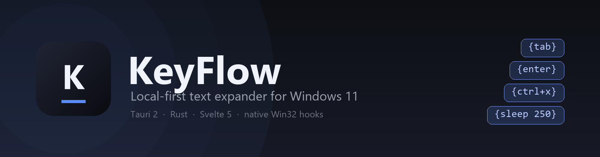
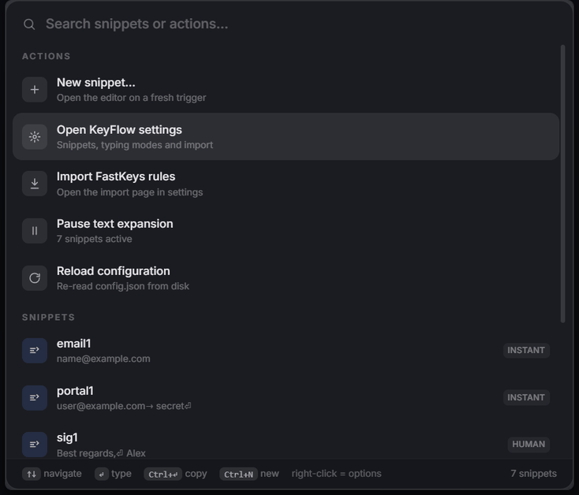

  

<h3 align="center">type a trigger, get the text</h3>

<b>A local-first text expander for Windows 11</b> 
Global triggers with key tokens, human-like typing modes, and a Ctrl+Space palette.

  
  
  
  
  

  

Type a trigger word anywhere on Windows and KeyFlow replaces it, and replacements can include special keys such as {tab} and {enter}. Press Ctrl+Space for a floating glass palette that searches snippets and actions.

KeyFlow is an independent project, not affiliated with or endorsed by FastKeys or asyar. The FastKeys importer reads a database file you already have on your machine, so existing rules can be carried over.

<table>
<tr>
<td width="50%" valign="middle">

### One palette for everything

Ctrl+Space opens a searchable palette: Enter types the snippet into the window you came from, Ctrl+Enter copies it, and the top of the list holds quick actions - new snippet, settings, import, pause, reload.

</td>
<td width="50%">
  
</td>
</tr>
<tr>
<td width="50%" valign="middle">

### Right-click any snippet

Every snippet has a full context menu: type it, copy it, copy the trigger, edit, duplicate, toggle Enabled or Case sensitivity, set the trigger mode or the standalone-word rule, pick the typing mode, or delete with an inline confirmation. Shift+F10 works on the selected row.

</td>
<td width="50%">
  
</td>
</tr>
<tr>
<td width="50%" valign="middle">

### Build replacements without memorising tokens

The editor has an Insert action palette grouped into keys, a combo builder, mouse clicks and timing. Click a chip to insert it at the caret or drag it onto the replacement field; a live preview highlights valid actions amber for anything that would be typed literally. Undo and redo cover both typing and inserted actions.

</td>
<td width="50%">
  
</td>
</tr>
<tr>
<td width="50%" valign="middle">

### Triggers that ask first

A snippet can be set to Confirm: the match parks, a small always-on-top prompt appears with the trigger name, and Enter inserts it, Esc cancels, any other key keeps typing. Manual snippets never fire from typing at all.

</td>
<td width="50%">
  
</td>
</tr>
<tr>
<td width="50%" valign="middle">

### Keep values off the screen

Mark a snippet as Sensitive and its value is blurred with a lock icon wherever it is previewed - the palette and the settings list - while the editor stays readable. The list also badges snippets that ask before firing or only run from the palette.

</td>
<td width="50%">
  
</td>
</tr>
</table>

Screenshots use demo snippets only.

## Features

- Global text expansion: case-insensitive triggers by default, with a per-snippet case sensitivity option
- Per-snippet trigger modes: Auto (expands while you type), Confirm (press Enter to insert) and Manual (palette only)
- "Standalone word only" option per snippet, so a trigger fires at a word boundary instead of inside a longer word
- Matcher hygiene: the typing buffer resets on Esc, after an idle pause of about 2.5s, on any mouse click and when the focused window changes
- Typing modes per snippet: instant, fast, human (jittered per-character delays) and slow
- Ctrl+Space palette with quick actions, fuzzy search and a per-snippet context menu
- Manager window with snippet list, editor, settings, and a FastKeys .fdb importer
- Per-snippet Sensitive flag for screenshots and screen recordings
- Tray icon: pause, start with Windows, reload configuration, exit. Native Win32 hooks, no AutoHotkey required
- Configuration: %APPDATA%\KeyFlow\config.json (readable JSON, reloaded when it changes on disk, written atomically with a config.backup.json snapshot of the previous revision)

<b>Replacement tokens</b>

Tokens are case-insensitive and use the {} syntax familiar from FastKeys and AutoHotkey.

| Kind | Tokens |
| --- | --- |
| Keys | {enter} {return} {tab} {space} {backspace} {delete} {esc} {up} {down} {left} {right} {home} {end} {pgup} {pgdn} {insert} {f1} to {f24} |
| Modifier combos | any combination of ctrl, shift, alt and win plus a final key, where letters, digits and all named keys work: {ctrl+x} {alt+f4} {shift+tab} {ctrl+shift+s} |
| Mouse | {lbutton} {rbutton} {mbutton} (also lclick, rclick, mclick) |
| Timing | {sleep 250} or {sleep 250ms} |

Anything else inside braces is typed literally, so {not-a-token} is safe in your text. A real newline in the replacement sends Enter, and a tab character sends Tab.

## Privacy

- No telemetry, no analytics, no network requests. Everything runs locally.
- Trigger detection uses global keyboard and mouse hooks with a small in-memory buffer of recently typed characters, used only for matching and discarded continuously. Nothing you type is stored or transmitted.
- Snippets are stored in plain text in %APPDATA%\KeyFlow\config.json, as with most text expanders. The Sensitive flag blurs values in the UI; it is not encryption.
- The log at %APPDATA%\KeyFlow\keyflow.log records matches with character counts and timings, not the expanded text.
- Writes are safe by default: config.json is written to a temporary file and renamed into place, and the previous revision is kept as config.backup.json. If config.json ever fails to parse it is preserved as config.unreadable.json instead of being replaced, and the reason is logged.
- Set the KEYFLOW_CONFIG_DIR environment variable to point KeyFlow at a different data folder (handy for testing, demos or a portable setup).

## Install

Download the latest KeyFlow_x.y.z_x64-setup.exe from Releases and run it; it installs per user. The installer is unsigned, so Windows SmartScreen may warn on first run (More info, then Run anyway). Start with Windows can be enabled from the tray menu or the Settings tab.

## Usage notes

- While KeyFlow runs, quit any other text expander (for example FastKeys) so the same trigger does not expand twice.
- Windows blocks synthetic input into elevated (admin) windows from normal processes; run KeyFlow elevated if you need expansion inside admin apps.
- Anti-cheat protected games often ignore hook-generated input.
- IME composition (Chinese/Japanese input) is not tracked, and triggers are matched from the letter and digit keys.
- If Ctrl+Space conflicts with another application, open the palette from the tray icon instead.

## Development

Requirements: Node 22+, Rust stable with the MSVC toolchain, and Visual Studio Build Tools with the C++ workload and the Windows SDK.

    npm install
    npm run tauri dev      # run with hot reload
    npm run tauri build    # produce the NSIS installer

Installer output: src-tauri/target/release/bundle/nsis/KeyFlow_<version>_x64-setup.exe

The app icon source is app-icon.png; regenerate the icon set with: npx tauri icon app-icon.png

scripts/e2e-test.ps1 drives a WinForms window and prints what an expansion produced (the header of that file lists the snippets it expects).

## Layout

- src/ - SvelteKit frontend (src/routes/+page.svelte dispatches palette, manager and confirm windows by label; src/lib/Palette.svelte, src/lib/Manager.svelte, src/lib/Confirm.svelte, src/lib/api.ts)
- src-tauri/src/win.rs - raw Win32 FFI declarations (no external windows crate)
- src-tauri/src/engine.rs - keyboard and mouse hooks, keystroke buffer, trigger matching, trigger modes
- src-tauri/src/exec.rs - SendInput executor, token parsing, typing modes
- src-tauri/src/fdb.rs - FastKeys .fdb parser and data file detection
- src-tauri/src/config.rs - configuration model and persistence
- assets/ - banner, screenshots and the palette animation used by this README
- docs/ - format and reverse-engineering notes

## Contributing

See CONTRIBUTING.md. Issues and pull requests are welcome; the templates ask for the version, your Windows build and the exact keystrokes.

## License

MIT, see LICENSE.

## Credits

UI direction inspired by asyar (https://github.com/Xoshbin/asyar). FastKeys interoperability notes live in docs/rea/fastkeys-5.10.md; FastKeys is a trademark of its respective owner.
