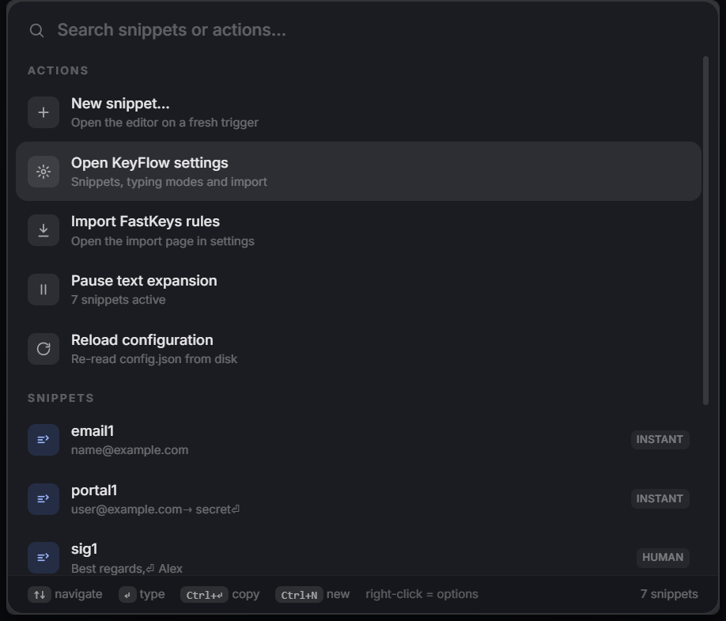
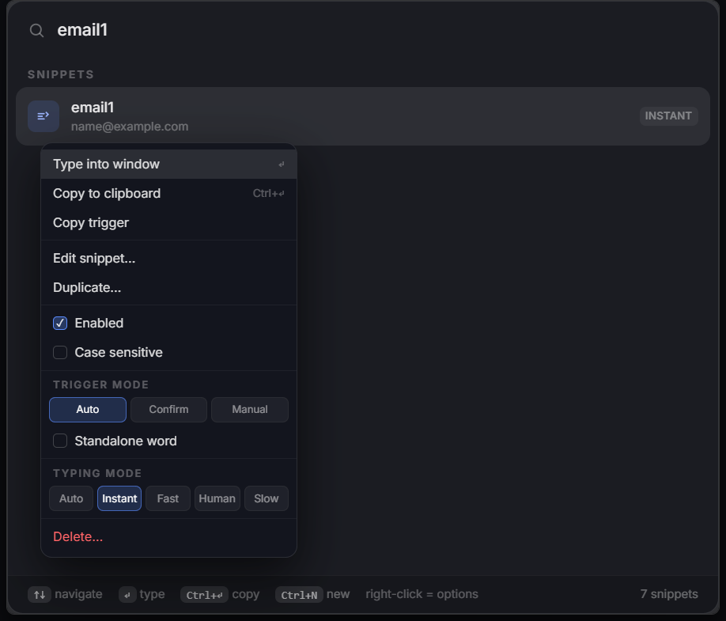
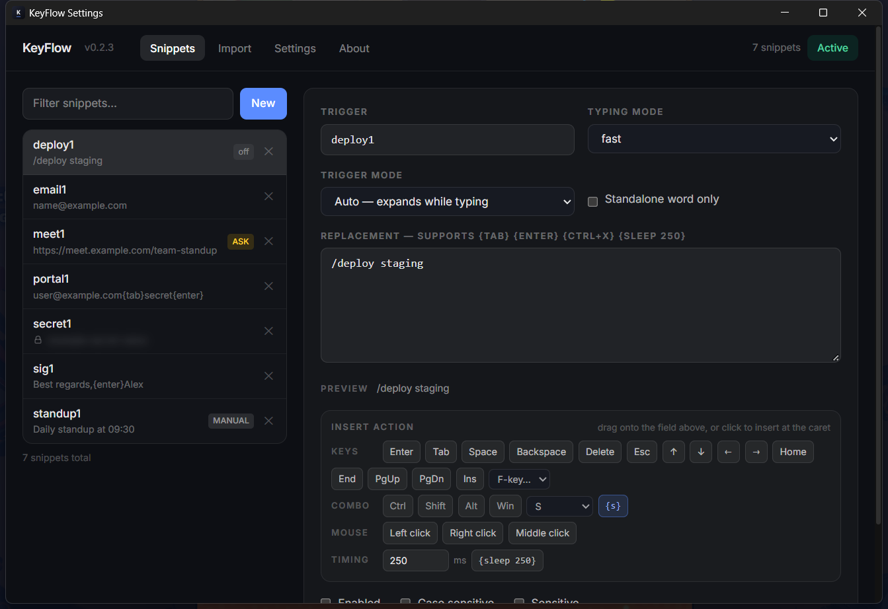
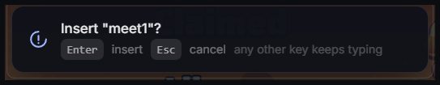
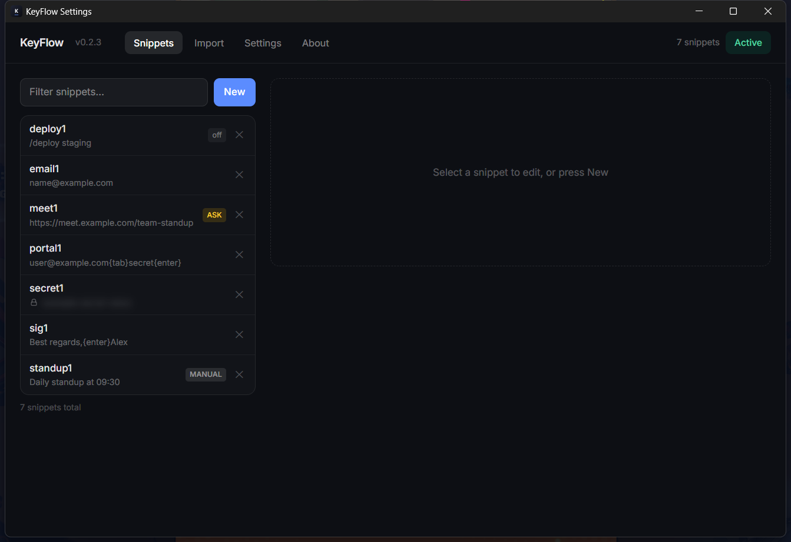
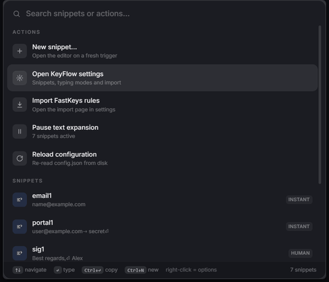

# KeyFlow

A local-first text expander for Windows 11, built with Tauri 2, Rust, SvelteKit (Svelte 5) and Tailwind CSS 4.

Type a trigger word anywhere and KeyFlow replaces it, and replacements can include special keys such as {tab} and {enter}. Press Ctrl+Space for a floating glass palette that searches snippets and actions.

KeyFlow is an independent project, not affiliated with or endorsed by FastKeys or asyar. The FastKeys importer reads a database file you already have on your machine, so existing rules can be carried over.

## Screenshots

Screenshots use demo snippets only.

## Features

- Global text expansion: case-insensitive triggers by default, with a per-snippet case sensitivity option
- Per-snippet trigger modes: Auto (expands while you type), Confirm (a small always-on-top prompt appears and waits for Enter; Esc cancels, any other key keeps typing) and Manual (never fires from typing, use Ctrl+Space)
- "Standalone word only" option per snippet, so a trigger fires at a word boundary (line start, space or punctuation) instead of inside a longer word
- Matcher hygiene: the typing buffer resets on Esc, after an idle pause of about 2.5s, on any mouse click and when the focused window changes, so half-typed triggers cannot fire later
- Typing modes per snippet: instant (a single batch, using a clipboard paste when the text is longer than a few characters, with automatic fallback to direct injection), fast, human (jittered per-character delays) and slow
- Replacement tokens (case-insensitive, {} syntax like FastKeys/AutoHotkey): {tab} {enter} {space} {backspace} {delete} {esc} {up} {down} {left} {right} {home} {end} {pgup} {pgdn} {insert} {f1} to {f24}; modifier combos with any combination of ctrl/shift/alt/win plus a key, where letters, digits and all named keys work as the final key ({ctrl+x}, {alt+f4}, {shift+tab}, {ctrl+shift+s}); {sleep 250} (or {sleep 250ms}) to pause; {lbutton} {rbutton} {mbutton} for mouse clicks. Unknown {tokens} are typed literally
- Ctrl+Space palette: quick actions at the top (New snippet, Open settings, Import FastKeys rules, Pause, Reload), fuzzy search, Enter types into the window you came from, Ctrl+Enter copies, Ctrl+N opens a new snippet, and right-clicking a snippet opens its full context menu (Type, Copy, Copy trigger, Edit, Duplicate, Enabled, Case sensitive, Trigger mode, Standalone word, Typing mode, Delete) - also reachable with Shift+F10 on the selected row
- Manager window (tray icon or palette actions) with snippet list, editor and settings. The editor has an organized Insert action palette (keys, combo builder, mouse, timing): click a token to insert it at the caret or drag it onto the replacement field, with a live preview that highlights valid actions, and undo/redo (Ctrl+Z, Ctrl+Shift+Z, Ctrl+Y, or the buttons) covering both typing and inserted actions until you save
- Per-snippet Sensitive flag: the value is blurred with a lock icon everywhere it is previewed (the palette and the settings list) and shows only in the editor. Made for screenshots and screen recordings; it hides the value from view and is not encryption
- FastKeys .fdb importer: converts existing Send-style entries into KeyFlow snippets
- Tray icon: pause, start with Windows, reload configuration, exit. Uses native Win32 hooks, no AutoHotkey required
- Configuration: %APPDATA%\KeyFlow\config.json (readable JSON, reloaded when it changes on disk)

## Privacy

- No telemetry, no analytics, no network requests. Everything runs locally.
- Trigger detection uses global keyboard and mouse hooks with a small in-memory buffer of recently typed characters, used only for matching and discarded continuously. Nothing you type is stored or transmitted.
- Snippets are stored in plain text in %APPDATA%\KeyFlow\config.json, as with most text expanders. The Sensitive flag blurs values in the UI; it is not encryption.
- The log at %APPDATA%\KeyFlow\keyflow.log records matches with character counts and timings, not the expanded text.

## Install

Download the latest KeyFlow_x.y.z_x64-setup.exe from Releases and run it; it installs per user. Start with Windows can be enabled from the tray menu or the Settings tab.

## Usage notes

- While KeyFlow runs, quit any other text expander (for example FastKeys) so the same trigger does not expand twice.
- Windows blocks synthetic input into elevated (admin) windows from normal processes; run KeyFlow elevated if you need expansion inside admin apps.
- Anti-cheat protected games often ignore hook-generated input.
- IME composition (Chinese/Japanese input) is not tracked, and triggers are matched from the letter and digit keys.
- If Ctrl+Space conflicts with another application, open the palette from the tray icon instead.

## Development

Requirements: Node 22+, Rust stable with the MSVC toolchain, and Visual Studio Build Tools with the C++ workload and the Windows SDK.

    npm install
    npm run tauri dev      # run with hot reload
    npm run tauri build    # produce the NSIS installer

Installer output: src-tauri/target/release/bundle/nsis/KeyFlow_<version>_x64-setup.exe

The app icon source is app-icon.png; regenerate the icon set with: npx tauri icon app-icon.png

scripts/e2e-test.ps1 drives a WinForms window and prints what an expansion produced (the header of that file lists the snippets it expects).

## Layout

- src/ - SvelteKit frontend (src/routes/+page.svelte dispatches palette, manager and confirm windows by label; src/lib/Palette.svelte, src/lib/Manager.svelte, src/lib/Confirm.svelte, src/lib/api.ts)
- src-tauri/src/win.rs - raw Win32 FFI declarations (no external windows crate)
- src-tauri/src/engine.rs - keyboard and mouse hooks, keystroke buffer, trigger matching, trigger modes
- src-tauri/src/exec.rs - SendInput executor, token parsing, typing modes
- src-tauri/src/fdb.rs - FastKeys .fdb parser and data file detection
- src-tauri/src/config.rs - configuration model and persistence
- docs/ - format and reverse-engineering notes

## Contributing

See CONTRIBUTING.md. Issues and pull requests are welcome; the templates ask for the version, your Windows build and the exact keystrokes.

## License

MIT, see LICENSE.

## Credits

UI direction inspired by asyar (https://github.com/Xoshbin/asyar). FastKeys interoperability notes live in docs/rea/fastkeys-5.10.md; FastKeys is a trademark of its respective owner.
